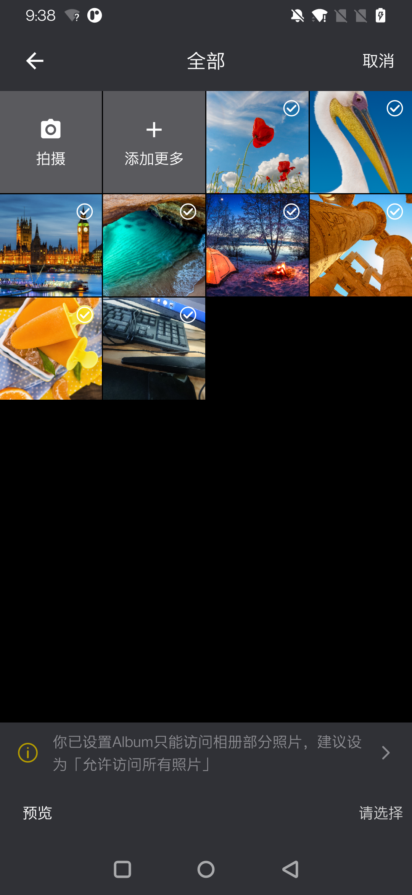
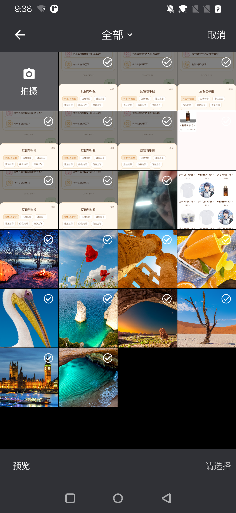
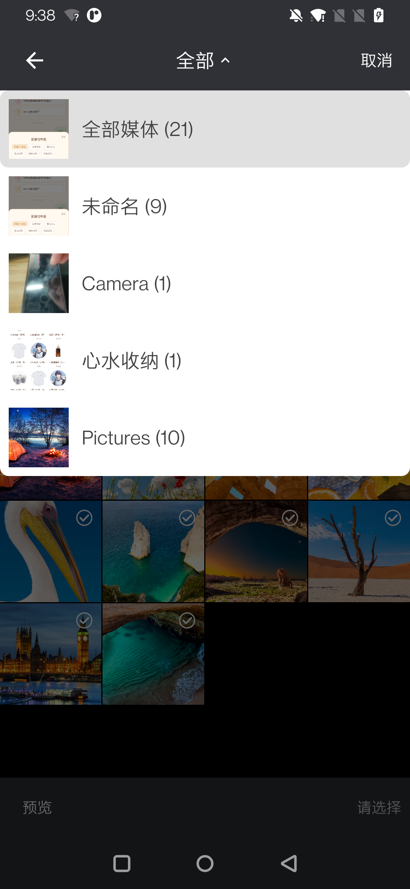
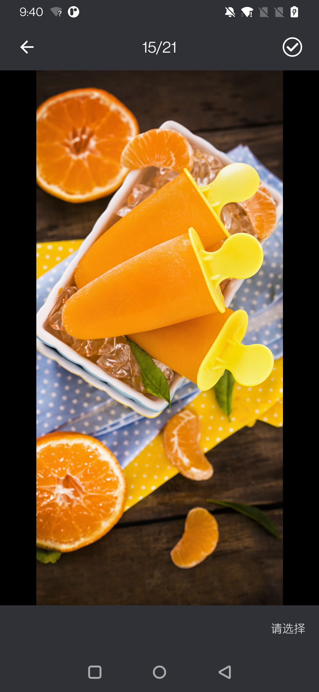

# Album

Album 是一个 Android 相册选择器，提供数据 API、传统 View 界面和 Jetpack Compose 界面。它支持图片、视频、混合媒体、多选、系统 Photo Picker、MediaStore 分页、相机拍摄、图片压缩以及选择结果文件化。

[](https://jitpack.io/#sceneren/Album)

## 效果预览

<p align="center">
  
  
  
  
</p>

## 模块

| 模块 | 用途 |
| --- | --- |
| `album-api` | 媒体模型、权限判断、MediaStore/Photo Picker 数据、分页、会话、相机和结果文件处理，不包含 UI |
| `album-ui-view` | 基于 Activity、RecyclerView 和 ViewPager2 的完整选择界面 |
| `album-ui-compose` | 可嵌入宿主导航的 Jetpack Compose 选择界面 |
| `album-video-api` | 轻量可插拔视频播放接口，不依赖 Media3、Compose 或图片加载库 |
| `album-video-media3` | 可选 Media3 播放实现，供宿主按需引入 |
| `app` | 同时演示 View 和 Compose 接入方式，不作为库发布 |

最低支持 Android 7.0（API 24）。UI 模块会传递依赖 `album-api`，宿主只需声明实际使用的 UI 模块。

## 添加依赖

项目通过 JitPack 发布。先在宿主项目的 `settings.gradle.kts` 中添加仓库：

```kotlin
dependencyResolutionManagement {
    repositoriesMode.set(RepositoriesMode.FAIL_ON_PROJECT_REPOS)
    repositories {
        google()
        mavenCentral()
        maven("https://jitpack.io")
    }
}
```

再在应用模块的 `build.gradle.kts` 中添加所需模块。把 `Tag` 替换为 GitHub 上已经通过 JitPack 构建的标签，例如 `1.0.0`：

```kotlin
val albumVersion = "Tag"

dependencies {
    // 传统 View 选择器
    implementation("com.github.sceneren.Album:album-ui-view:$albumVersion")

    // Compose 选择器；不使用时无需添加
    implementation("com.github.sceneren.Album:album-ui-compose:$albumVersion")

    // 可选的视频播放实现；不添加、不注册时，预览回退为静态视频封面
    implementation("com.github.sceneren.Album:album-video-media3:$albumVersion")

    // 仅使用数据能力时添加；UI 模块已经传递此依赖
    // implementation("com.github.sceneren.Album:album-api:$albumVersion")
}
```

多模块制品的坐标为 `com.github.sceneren.Album:<模块名>:<Tag>`。建议按需依赖单个模块，避免引入不使用的 UI 实现。

## 声明权限

宿主应用需要在 `AndroidManifest.xml` 中声明媒体读取权限：

```xml
<uses-permission
    android:name="android.permission.READ_EXTERNAL_STORAGE"
    android:maxSdkVersion="32" />
<uses-permission android:name="android.permission.READ_MEDIA_IMAGES" />
<uses-permission android:name="android.permission.READ_MEDIA_VIDEO" />
<uses-permission android:name="android.permission.READ_MEDIA_VISUAL_USER_SELECTED" />
```

- UI 模块会根据 `AlbumMediaFilter` 请求实际需要的权限。只使用 `album-api` 时，可用 `AlbumMediaPermissionRequestFactory.create(filter)` 生成请求列表。相机功能通过系统 Activity 完成，宿主不需要声明 `CAMERA` 权限。
- 也可以不添加权限，默认走系统 Photo Picker。打开选择界面时，可以配置不申请权限。

## 配置图片加载器

库不强制依赖 Coil 或 Glide。宿主必须在自定义 `Application.onCreate()` 中为所使用的 UI 模块配置 `AlbumImageLoader`，并在 Manifest 的 `<application android:name="...">` 中注册该 Application。

下面是 View 使用 Coil 的最小示例：

```kotlin
class App : Application() {
    override fun onCreate() {
        super.onCreate()

        AlbumUi.setImageLoader(
            object : AlbumImageLoader {
                override fun load(
                    imageView: ImageView,
                    media: AlbumMedia,
                    target: AlbumImageTarget,
                ) {
                    imageView.load(media.uri)
                }

                override fun clear(imageView: ImageView) {
                    imageView.load(null)
                }
            },
        )
    }
}
```

Compose 的 Coil 配置、视频封面解码和完整导入见[相册选择器使用说明](docs/相册选择器使用说明.md)。

## 自定义 Toast（可选）

在 `Application.onCreate()` 中为实际使用的 UI 模块注册 `AlbumToastHandler`，即可通过宿主自己的方式显示提示。支持直接传入 lambda：

```kotlin
val appContext = applicationContext
com.github.sceneren.album.ui.view.AlbumUi.setToastHandler { message ->
    // 替换为宿主自己的 Toast 工具或自定义样式。
    Toast.makeText(appContext, message, Toast.LENGTH_LONG).show()
}
com.github.sceneren.album.ui.compose.AlbumUi.setToastHandler { message ->
    Toast.makeText(appContext, message, Toast.LENGTH_LONG).show()
}
```

示例中的 `Toast` 来自 `android.widget.Toast`，`appContext` 为初始化时获取的 Application Context。回调在主线程执行，仅接收完整的 `CharSequence` 提示内容；设置后库不再额外显示系统 Toast。Compose 的完整页和嵌入内容均支持。未设置或调用 `setToastHandler(null)` 时使用默认系统短 Toast。回调为进程级配置，请避免捕获或长期保存 Activity。

## 可选视频播放

UI 模块只依赖轻量 `album-video-api`，不会传递引入 Media3。宿主引入 `album-video-media3` 后，在 `Application.onCreate()` 注册：

```kotlin
val videoPlayerFactory =
    com.github.sceneren.album.video.media3.Media3AlbumVideoPlayerFactory()
com.github.sceneren.album.ui.view.AlbumUi.setVideoPlayerFactory(videoPlayerFactory)
com.github.sceneren.album.ui.compose.AlbumUi.setVideoPlayerFactory(videoPlayerFactory)
```

只注册实际使用的 UI 即可。视频预览提供顶部悬浮返回，以及底部半透明胶囊播放/暂停、拖动进度、静音操作栏，默认自动播放并静音；切后台、翻页和退出时释放播放器。未注册或调用 `setVideoPlayerFactory(null)` 时保留静态封面展示，不显示播放操作栏。

也可以不引入 Media3，直接实现 `AlbumVideoPlayerFactory` / `AlbumVideoPlayer` 接入其他引擎。Compose 的 `AlbumPicker` / `AlbumPickerContent` 还可通过 `videoPlayerFactory` 参数按次覆盖；显式传 `null` 可禁用该次播放。接口与接入约束见[视频播放配置](docs/相册选择器使用说明.md#可选视频播放与自定义引擎)。

## View 快速开始

```kotlin
private val albumPicker = registerForActivityResult(AlbumPickerContract()) { result ->
    result?.items.orEmpty().forEach { item ->
        // 统一使用 item.resultUri，通过 ContentResolver 流式读取、展示或上传
        // item.originalUri 保留原始媒体身份；未压缩时两个 URI 相同
    }
}

private fun openAlbum() {
    albumPicker.launch(
        AlbumPickerRequest(
            config = AlbumPickerConfig(
                mediaFilter = AlbumMediaFilter.IMAGES_AND_VIDEOS,
                maxSelectionCount = 9,
            ),
        ),
    )
}
```

## Compose 快速开始

```kotlin
var showAlbum by rememberSaveable { mutableStateOf(false) }

if (showAlbum) {
    AlbumPicker(
        config = AlbumPickerConfig(
            mediaFilter = AlbumMediaFilter.IMAGES,
            maxSelectionCount = 9,
        ),
        onResult = { result ->
            handleAlbumResult(result)
            showAlbum = false
        },
        onCancel = { showAlbum = false },
    )
} else {
    Button(onClick = { showAlbum = true }) {
        Text("选择图片")
    }
}
```

Compose 版本不声明独立 Activity。宿主负责把 `AlbumPicker` 放入自己的导航或条件布局，并在完成或取消后将其移除。

### Compose 系统栏颜色

`album-ui-compose` 会自动处理宿主 `Activity` 的系统栏，宿主无需调用 `enableEdgeToEdge()` 或手动设置 Window。选择器显示时，状态栏使用 `AlbumPickerAppearance.toolbarColor`，导航栏使用 `bottomBarColor`；未配置时使用组件默认颜色。组件还会根据颜色亮度自动选择深色或浅色系统图标，并在 Android 10 及以上关闭导航栏强制对比度遮罩。

内部通过 `DisposableEffect` 保存宿主原有的系统栏颜色、图标明暗模式和导航栏对比度设置，在 `AlbumPicker` 离开组合时逐项恢复。因此完成或取消选择后，宿主页面原有的系统栏样式不会被永久修改。Android 15 及以上由组件现有的系统栏 inset 背景负责覆盖透明系统栏区域，旧版系统则同时使用 Window 系统栏颜色兼容非 edge-to-edge 宿主。

## URI 结果与压缩文件

确认后统一返回 URI，不再复制原图或原视频，也不返回文件路径：

- `originalUri`：用户选择的原始媒体 URI。
- `resultUri`：最终消费的 URI。未压缩、按大小跳过压缩和视频直接返回原始 URI；压缩图片返回本库 FileProvider URI。
- `mediaType` / `compressionStatus`：媒体类型和压缩状态。

压缩直接从 URI 读取，只有压缩结果写入 `getExternalFilesDir(null)/luban`；没有临时原图副本。相机原有输出保留并直接返回 URI。

宿主在 IO 线程使用 `contentResolver.openInputStream(item.resultUri)` 流式上传。原始 URI 依赖提供方媒体仍存在且授权有效；Photo Picker 会尽可能保留持久读取授权。跨应用传递使用 URI 和临时读取授权。

压缩文件容量预算默认为确认时当前可用存储的一半。空间不足时按 LRU 清理旧的未使用文件；当前处理及未释放结果受到保护。压缩输出自身超过预算时提示“选择的文件太大”，失败/取消不留下未完成输出。

上传和其他消费者完成后调用 `albumApi.releaseGeneratedMedia(context, result)`，将压缩结果标为可回收；仍在使用或后台上传中的结果不要提前释放。保留完整 `result`（含租约标识）以便任务完成后释放。重复释放安全。`deleteGeneratedMedia(context, item.resultUri)` 显式删除本库生成的 URI；`clearGeneratedMedia(context)` 显式清理包括相机输出的全部生成文件。两者都不会删除原始 MediaStore/Photo Picker 媒体。

这是结果接口变更：旧版路径字段和基于路径的删除入口已移除，接入方需改为 URI。

## 更多文档

- [完整接入与使用说明](docs/相册选择器使用说明.md)
- [GitHub 与 JitPack 发布说明](docs/JitPack发布说明.md)
- [JitPack Android Library 官方指南](https://docs.jitpack.io/android/)
- [Android Library 发布官方指南](https://developer.android.com/build/publish-library)

## 致谢

感谢以下开源项目及其作者、贡献者为 Album 提供支持：

| 第三方库 | GitHub 地址 | 在项目中的用途 |
| --- | --- | --- |
| Luban（鲁班） | [Curzibn/Luban](https://github.com/Curzibn/Luban) | 在 `album-api` 中用于选择结果的图片压缩。用户确认选择后，根据压缩配置处理符合条件的图片，并返回压缩后的文件路径；视频不参与压缩。 |
| AndroidX Media3 | [androidx/media](https://github.com/androidx/media) | 仅在可选 `album-video-media3` 中提供视频播放引擎，宿主可替换或省略。 |
| ZoomImage | [panpf/zoomimage](https://github.com/panpf/zoomimage) | 在 `album-ui-view` 和 `album-ui-compose` 中分别通过 `ZoomImageView` 和 `ZoomImage` 实现大图预览，提供图片缩放、拖动等手势交互；图片加载仍由宿主配置的 `AlbumImageLoader` 负责。 |

## 本地验证

```powershell
.\gradlew.bat :album-api:testDebugUnitTest :album-ui-view:testDebugUnitTest :album-ui-compose:testDebugUnitTest :album-video-media3:testDebugUnitTest :app:testDebugUnitTest
.\gradlew.bat :album-api:assembleDebug :album-ui-view:assembleDebug :album-ui-compose:assembleDebug :album-video-api:assembleDebug :album-video-media3:assembleDebug
```

发布版本前还应运行本地 Maven 发布验证，具体命令见[GitHub 与 JitPack 发布说明](docs/JitPack发布说明.md)。
